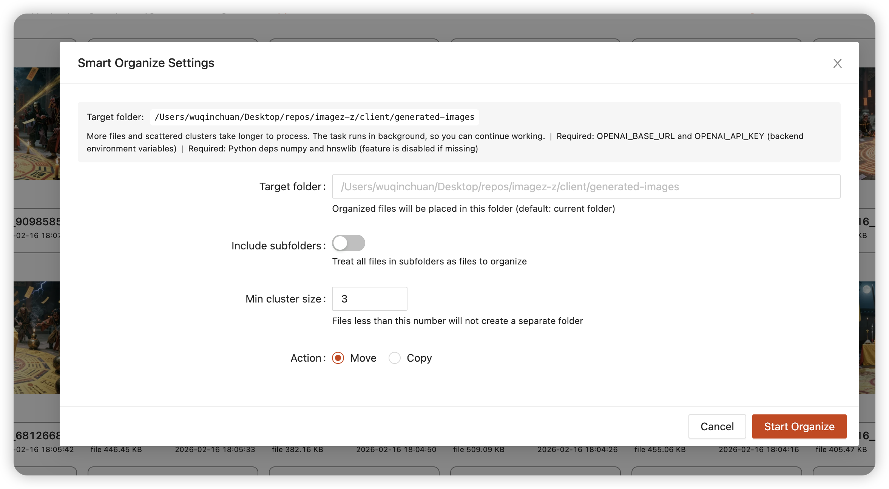
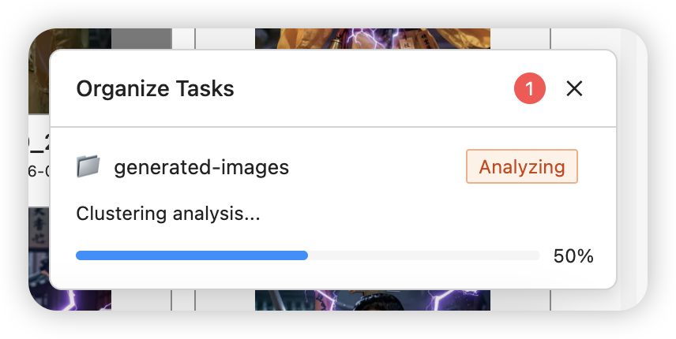
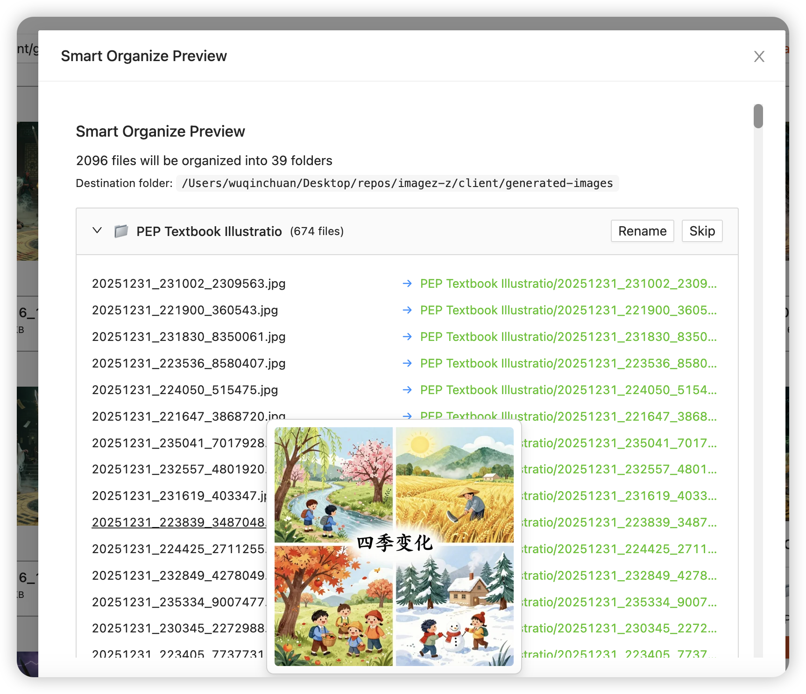
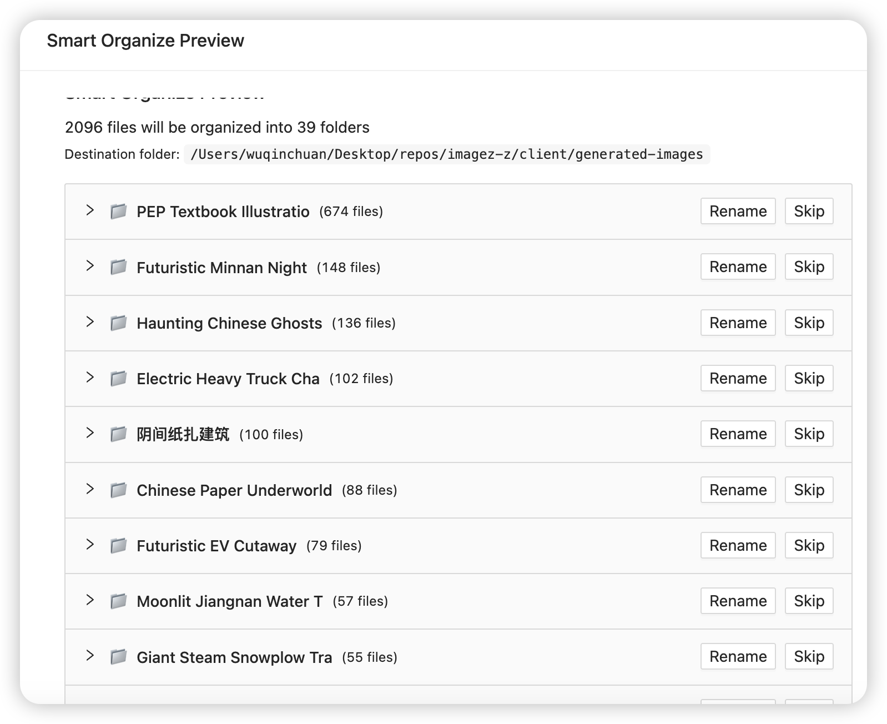
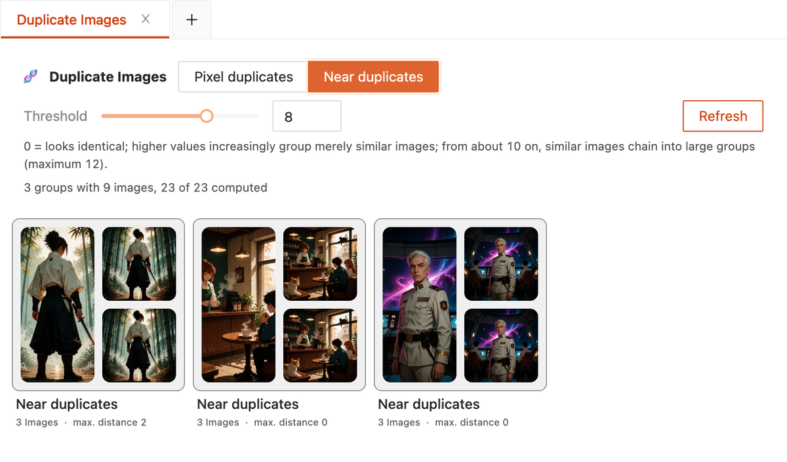
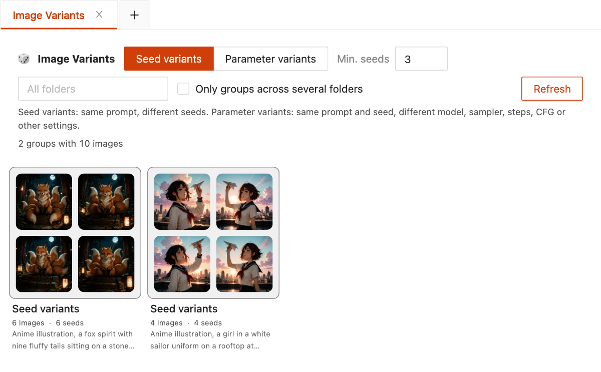
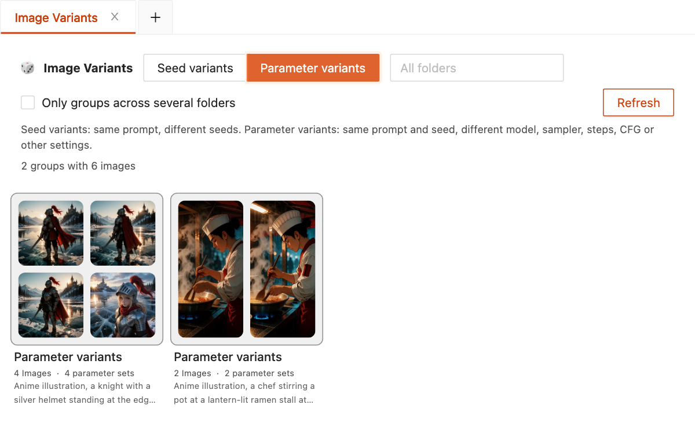

  
> ✨ 同一作者的新应用：[SpindleStudio](https://github.com/zanllp/SpindleStudio)——Threads 式并发生图工作台，生成的图片自带 SD WebUI 兼容元数据，IIB 开箱即可索引。

# 无边图像浏览


[查看近期更新](./CHANGELOG.md)

[安装/运行](#安装运行)


## 主要特性

### 🔥 极佳性能
- 存在缓存的情况下后，图像可以在几毫秒内显示。
- 默认使用缩略图显示图像，默认大小为512像素，您可以在全局设置页中调整缩略图分辨率。
- 你还可以控制网格图像的宽度，允许以64px到1024px的宽度范围进行显示
- 支持通过`--generate_video_cover`和`--generate_image_cache`来预先生成缩略图和视频封面，以提高性能。
- 支持通过`IIB_CACHE_DIR`环境变量来指定缓存目录。
- 可通过`IIB_IMAGE_HASH_THREADS`环境变量设置[重复图像](#重复图像)视图计算图片哈希所用的线程数（默认 3，范围 1 到 8）。

### 🔍 图像搜索和收藏
- 将会把Prompt、Model、Lora等信息转成标签，将根据使用频率排序以供进行精确的搜索。
- 支持标签自动完成、[翻译](https://github.com/zanllp/sd-webui-infinite-image-browsing/issues/39)和自定义。
- 可通过在右键菜单切换自定义标签来实现图像收藏。
- 支持类似谷歌的高级搜索。
- 同样支持模糊搜索，您可以使用文件名或生成信息的一部分进行搜索。
- 支持添加自定义搜索路径，方便管理自己创建的文件夹集合。
- 支持媒体类型筛选、视频标签搜索与随机排序。
- 支持按规则自动打标签。

### 🎵 TikTok 风格浏览
- TikTok 式纵向刷图/刷视频体验。
- 信息面板与背景遮罩持续优化，预览返回更顺畅。
- 删除操作在 TikTok 视图中保持同步。

### 🖼️ 查看图像/视频和“发送到”
- 支持查看图像生成信息。全屏预览下同样支持。
- EXIF/元数据集成在全屏预览中，支持分层浏览与高亮显示。
- 支持将图像发送到其他选项卡和其他插件，例如 ControlNet, openOutpaint。
- 支持全屏预览，并且支持在全屏预览下使用自定义快捷键进行操作
- 支持在全屏预览模式下通过按下方向键或点击按钮移动到前一个或后一个图像。
- 支持播放远程服务器上的视频文件

### 💻 多种使用方法
- 您可以将其作为 SD-webui 的扩展安装。
- 您可以使用 Python 独立运行它。
- 还提供桌面应用程序版本。
- 支持多种流行的AI软件
- **NEW**：[与 AI 助手一起使用](docs/ai-agents-zh.md)（Claude Code、Cursor、OpenClaw 等）

### 🚶‍♀️ Walk模式
- 自动加载下一个文件夹 `(类似于 os.walk)`，可让您无需分页浏览所有图像。
- 已测试可正常处理超过 27,000 个文件。
- 当存在文件夹的情况下你可以通过右上角的walk按钮从其他模式切换到walk模式，它会将所有的文件夹打平，避免来回进出文件夹的繁琐操作。

### 🌳 基于文件树结构的预览和文件操作
- 支持基于文件树结构的预览。
- 支持自动刷新。
- 支持基本文件操作以及多选删除/移动/复制，新建文件夹等。
- 按住 Ctrl、Shift 或 Cmd 键可选择多个项目。
  - 支持多选的操作有：删除、移动、复制、打包下载、添加标签、移除标签，移动到其他文件夹，复制到其他文件夹，拖拽
  - 你可以通过右下角的保持多选按钮来保持多选的状态，对选中的文件集合可以很方便的进行多次操作
- 支持拖拽到文件夹，移动/复制支持“出错继续”。

### 🆚 图像对比 (类似ImgSli)
- 提供两张图片的并排比较
- 同时提供图像生成信息的比较

### 🧠 Topic/Tag 分析
- 标签关系图可视化与主题聚类联动。

### 🧬 重复图像
根据图片内容查找重复和近似重复的图片，与文件名和元数据无关。

- **像素重复**：像素完全相同的图片，即使文件名、编码或元数据不同
- **近似重复**：看起来几乎一样的图片（重新编码、缩放、轻微修改）；通过阈值设置相似程度
- **文件夹式卡片**：每个分组是一张带缩略图拼贴的卡片，点击后在网格中打开该分组，可照常选择、打标签、删除
- **增量后台任务**：只为新增和已修改的图片计算哈希，显示进度并可取消；打开视图时自动启动任务

> **前置条件**：Python 依赖 `numpy` 和 `Pillow`
>
> 📸 查看下方[重复图像预览](#重复图像)获取截图和详细说明

### 🎲 图像变体
根据元数据找出由同一提示词生成的图片并分组。

- **种子变体**：提示词相同，种子不同（批量生成、重新抽卡、另一天使用同一提示词）
- **参数变体**：提示词和种子相同，模型、采样器、步数、CFG 或其他设置不同（模型与采样器测试、X/Y/Z 图、开启与关闭高清修复的对比）
- **与重复图像相同的卡片**：每组显示图片数量、种子数或参数组数以及提示词；点击即在网格中打开
- **筛选**：最少种子数、文件夹，以及仅显示跨多个文件夹的分组

> **前置条件**：Python 依赖 `numpy`
>
> 📸 查看下方[图像变体预览](#图像变体)获取截图和详细说明

### 🗂️ 智能整理
AI 驱动的自动文件整理 

- **语义聚类**：基于 AI 向量化技术，自动将语义相似的图片分组
- **智能命名**：AI 自动生成有意义的文件夹名称，支持多语言
- **预览确认**：执行前可预览整理方案，支持跳过或调整特定分组
- **后台处理**：大文件夹在后台异步处理，不影响继续使用
- **灵活配置**：支持移动/复制、设置最小聚类大小、递归处理子文件夹

> **前置条件**：与自然语言搜索相同 - 需要配置 `OPENAI_BASE_URL`、`OPENAI_API_KEY`，以及 Python 依赖 `numpy`、`hnswlib`
>
> 📸 查看下方[智能整理预览](#智能整理-1)获取截图和视频演示

### 🌐 多语言支持
- 目前支持简体中文/繁体中文/英文/德语。
- 如果您希望添加新的语言，请参考 [i18n.ts](https://github.com/zanllp/sd-webui-infinite-image-browsing/blob/main/vue/src/i18n/zh-hans.ts) 并提交相关的代码。


### 🔐 隐私和安全
- 支持自定义secret key来进行身份验证
- 支持配置对文件系统的访问控制，默认将在服务允许公开访问时启用(仅限作为sd-webui的拓展时)
- 支持自定义访问控制允许的路径。
- 支持控制访问权限。你可以让IIB以只读模式运行
- [点击这里查看详情](.env.example)

### ⌨️ 快捷键
- 支持删除和添加/移除Tag，在全局设置页进行自定义触发按钮

### 📦 打包 / 批量下载
- 允许你一次性打包下载多个图像
- 数据来源可以是搜索结果/普通的图像网格查看页面/walk模式等。使用拖拽或者“发送到”都可将图片添加待处理列表


如果您喜欢这个项目并且觉得它对您有帮助，请考虑给我点个⭐️。这将对我持续开发和维护这个项目非常重要。如果您有任何建议或者想法，请随时在issue中提出，我会尽快回复。再次感谢您的支持！


[在微信上赞助我](.github/wechat_funding.jpg)

<a href='https://ko-fi.com/zanllp' target='_blank'>


[视频演示可以在Bilibili上观看](https://space.bilibili.com/27227392/channel/series)

# 安装/运行

## 作为SD-webui的扩展程序:
1. 在SD-webui中打开`扩展`选项卡。
2. 选择`从URL安装`选项。
3. 输入 `https://github.com/zanllp/sd-webui-infinite-image-browsing`。
4. 点击`安装`按钮。
5. 等待安装完成，然后点击`应用并重启UI`。

## 作为使用Python运行的独立程序（不需要SD-webui）:
请参考[Can the extension function without the web UI?](https://github.com/zanllp/sd-webui-infinite-image-browsing/issues/47)

如果需要查看ComfyUI/Fooocus/NovelAI生成的图片相关，请先参考 https://github.com/zanllp/sd-webui-infinite-image-browsing/issues/202#issuecomment-1655764627

如果你需要dockerfile 参考  https://github.com/zanllp/sd-webui-infinite-image-browsing/discussions/366

## 作为桌面应用程序（不需要SD-webui和Python）:
exe版本同样支持ComfyUI/Fooocus/NovelAI

从仓库页面右侧的`releases`部分下载并安装程序。如果提示检测到病毒忽略即可这是误报。在windows下的编译有两个版本, pyinstaller版本拥有比较低的误报率。

Windows 和 macOS 桌面版发现新版本时，点「立即更新」即可安装并重启。没有内置更新功能的旧版仍需手动安装一次。

### macOS（未公证预览版）

Apple Silicon（M 系列）下载 `aarch64-unsigned.dmg`，Intel 下载 `x64-unsigned.dmg`，需要 macOS 14 或更新版本。将 **Infinite Image Browsing** 拖入「应用程序」后再打开，不要直接从磁盘映像运行。

这些安装包没有 Apple Developer ID 签名，也未经公证。如果被系统拦截，请参考 [Apple 关于打开未公证应用的说明](https://support.apple.com/zh-cn/102445)，仅在信任本仓库下载来源时允许打开。不要全局关闭 Gatekeeper。包内代码的 ad-hoc 签名用于完整性校验，不代表已获 Apple 认证。

如果已确认是可信的官方安装包，仍无法启动，可执行以下命令，仅清除**这个应用及其内置后端**的下载隔离标记：

```sh
xattr -dr com.apple.quarantine "/Applications/Infinite Image Browsing.app"
```

这是针对单个应用的明确例外，不代表通过 Apple 认证。不要对整个下载目录或磁盘执行此命令。两种架构的 macOS 安装包均已验证清除该标记后可以运行，但原始下载包仍会被 Gatekeeper 拦截。

桌面版会启动内置 Python 后端。如果窗口已打开但后端没有启动，仅放行主程序可能还不够；请检查 `~/Library/Application Support/com.zanllp.iib/` 中的 `iib_api_server.log`，反馈时附上相关错误。数据库、备份、`.env` 和可选的 `app.conf.json` 也存放在这个目录，而非应用包内。桌面、文稿等受保护目录的访问权限，需另在「系统设置 > 隐私与安全性 > 文件与文件夹」管理。

如果你需要自行编译请参考 https://github.com/zanllp/sd-webui-infinite-image-browsing/blob/main/.github/workflows/tauri_app_build.yml
## 作为库使用

使用iframe接入IIB，将IIB作为你应用的文件浏览器使用。 参考 https://github.com/zanllp/sd-webui-infinite-image-browsing/blob/main/vue/usage.md

## 作为 AI 助手技能

IIB 可以与 Claude Code、Cursor 和 OpenClaw 等 AI 助手一起使用。详情请参阅 [AI 助手文档](docs/ai-agents-zh.md)。

# 预览


## 图像搜索

在第一次使用时，你需要点击等待索引的生成，我2万张图像的情况下大概需要15秒（配置是amd 5600x和pcie ssd）。后续使用他会检查文件夹是否发生变化，如果发生变化则需要重新生成索引,通常这个过程极快。

图像搜索支持翻译，具体看这个 https://github.com/zanllp/sd-webui-infinite-image-browsing/issues/39 。


## 图像比较


## 全屏预览 (并排布局)


## 全屏预览


在全屏预览下同样可以查看图片信息和进行上下文菜单上的的操作，支持拖拽/调整/展开收起

https://user-images.githubusercontent.com/25872019/235327735-bfb50ea7-7682-4e50-b303-38159456e527.mp4


如果你和我一样不需要查看生成信息，你可以选择直接缩小这个面板，所有上下文操作仍然可用


### 右键菜单


也可以通过右上角的图标来触发


### Walk模式


https://user-images.githubusercontent.com/25872019/230768207-daab786b-d4ab-489f-ba6a-e9656bd530b8.mp4


### 深色模式


## 智能整理

AI 驱动的自动文件整理 - 自动将相似图片分组并创建有意义的文件夹。









https://github.com/user-attachments/assets/c1279556-d255-4e71-b230-48523a4859bf

## 重复图像



根据图片内容计算的**像素重复**和**近似重复**分组。从启动页打开（**重复图像**）。

### 使用方式

1. 在启动页打开**“重复图像”**。如果图片尚未计算哈希，视图会启动后台任务并显示进度（**取消**可停止，已完成的部分会保留）。
2. 在**像素重复**和**近似重复**之间切换。对近似重复，**阈值**（0–12，默认 8）决定图片需要多相似：`0` 表示“看起来相同”，更大的值也会把只是相似的图片分到一组，约 10 以上时相似图片会连成很大的分组。
3. 每张卡片代表一个分组，显示图片数量（近似重复还显示成员之间的最大距离）。点击后在网格中打开该分组：图片按相似度排序，最典型的排在最前。可照常选择、打标签、删除。
4. **刷新**重新加载分组；**计算缺失项**为尚未计算哈希的图片计算哈希。

> 当未计算的图片不超过 20000 张时，任务会自动启动；超过时请点击**计算缺失项**。只读模式（`IIB_ACCESS_CONTROL_PERMISSION=read-only`）下不会计算，视图只显示已计算的结果。

### 原理

- **像素哈希**：对解码后的像素（第一帧，透明部分按白色处理，16 位缩放为 8 位）计算 SHA-256。EXIF 方向会被忽略，因此像素相同、方向标记不同的图片也算像素重复。
- **感知哈希**：64 位 pHash（32×32 灰度图的 DCT）。近似重复是汉明距离不超过阈值的图片的连通分量，且一组至少需要两个不同的像素哈希。纯色图片不参与近似分组。
- **排序**：每张图片保存一张 32×32 灰度缩略图；组内按与最典型图片的相关性排序。
- **存储**：表 `image_hash`（每张图片约 1.1 KB）。当图片的文件大小或修改时间改变，或算法版本改变时会重新计算。无法解码的图片会被记为失败；无法读取的图片（文件缺失、权限问题）会在下一次任务中重试。
- **开销**：约 5000 张图片首次运行在 3 个线程下约 35 秒；之后只处理新增和已修改的图片。5 万张图片的分组每个数据状态只需几秒一次，之后调整阈值几乎没有开销。

### 配置

- **`IIB_IMAGE_HASH_THREADS`**：哈希任务的线程数，默认 `3`，范围 `1` 到 `8`

### 接口

所有路由位于 `/infinite_image_browsing/db/` 下。

- **状态**：`GET image_groups_state` 返回 `total`、`hashed`、`failed`、`pending`、`skipped`、`version` 以及正在运行的 `job`
- **启动 / 取消任务**：`POST image_groups_job_start`（返回 `job_id`，若已有任务在运行则加入该任务）和 `POST image_groups_job_cancel`；二者都需要写权限
- **任务状态**：`GET image_groups_job_status?job_id=...`（`queued`、`running`、`done`、`cancelled`、`error`，以及 `done`、`total`、`skipped`）
- **分组**：`POST image_groups`，参数 `kind`（`pixel` 或 `near`）、`threshold`、`min_size`、`offset`、`limit`（最大 1000）；每个分组包含 `id`、`size`、`max_distance`，`images` 为前四个文件信息，`paths` 为全部路径。当 `has_more` 为 true 时用 `next_offset` 继续。

## 图像变体





根据生成元数据得到的**种子变体**和**参数变体**分组。从启动页打开（**图像变体**）。

### 使用方式

1. 在启动页打开**“图像变体”**。无需后台任务：分组来自索引中已有的元数据。
2. 在**种子变体**和**参数变体**之间切换。对于种子变体，**最少种子数**（默认 3）决定一组至少需要多少个不同的种子。
3. 可以把分组限定在某些**文件夹**（选择图库文件夹或输入路径），或**仅显示跨多个文件夹的分组**，以隐藏单个批次内的种子。
4. 每张卡片显示图片数量、种子数或参数组数以及提示词。点击后在网格中打开该分组。若已有[重复图像](#重复图像)计算的图片哈希，图片按相似度排序，否则按日期排序。

### 原理

- **提示词**：去掉 `<lora:…>` 标签后的正向提示词原文、负向提示词，以及 LoRA（名称和权重，已排序）。没有正向提示词的图片不参与分组，视图会统计其数量。没有种子的图片同样不参与（内置的 ComfyUI 解析器不写入种子）。
- **种子变体**：提示词相同、且不同种子数不少于设定值的图片。
- **参数变体**：提示词、种子和尺寸相同，但生成参数不止一组的图片：参数行中除种子、尺寸和来源外的全部字段，例如模型、采样器、步数、CFG、Clip skip、高清修复或 ADetailer。
- **开销**：分组在每个数据状态下只计算一次并缓存。10 万张图片的读取和分组约需 1 秒，命中缓存的请求约 0.2 秒。

### 接口

所有接口位于 `/infinite_image_browsing/db/` 下。

- **分组**：`POST image_variants`，参数 `kind`（`seed` 或 `params`）、`min_seeds`（2–100，默认 3，仅种子变体）、`folder_paths`、`multi_folder`、`offset` 和 `limit`（最多 1000）；每组包含 `id`、`size`、`variant_count`（种子数或参数组数）、截短的 `prompt`、`images` 中前四张图片的文件信息以及 `paths` 中的全部路径。`no_prompt` 为没有正向提示词或参数行的图片数。当 `has_more` 为 true 时用 `next_offset` 继续。

## 自然语言分类&搜索（实验性）

这个功能用于把图片按**提示词语义相似度**自动分组（主题），并支持用一句自然语言做**语义检索**（类似 RAG 的召回阶段）。  
它是实验性功能：效果强依赖模型与提示词质量，适合快速找回/整理生成图片。

### 使用方式（面向使用者）

1. 打开首页「**自然语言分类&搜索（实验性）**」
2. 点击「范围」选择要处理的文件夹（可多选，来源于 QuickMovePaths）
3. **归类**：点「刷新」会在所选范围内生成主题列表（标题会按前端语言输出）
4. **搜索**：输入一句话点「搜索」，会自动打开结果页（TopK 相似图片）

> 选择的范围会持久化到后端 KV（`app_fe_setting["topic_search_scope"]`），下次打开会自动恢复并自动刷新一次结果。

### 接口（给高级用户/二次开发）

- **构建/刷新向量**：`POST /infinite_image_browsing/db/build_iib_output_embeddings`
  - 入参：`folder`, `model`, `force`, `batch_size`, `max_chars`
- **归类（聚类）**：`POST /infinite_image_browsing/db/cluster_iib_output_job_start`，然后轮询 `GET /infinite_image_browsing/db/cluster_iib_output_job_status?job_id=...`
  - 入参：`folder_paths`（必填，数组）、`threshold`, `min_cluster_size`, `force_embed`, `title_model`, `force_title`, `use_title_cache`, `assign_noise_threshold`, `lang`
- **语义检索（RAG 召回）**：`POST /infinite_image_browsing/db/search_iib_output_by_prompt`
  - 入参：`query`, `folder_paths`（必填，数组）、`top_k`, `min_score`, `ensure_embed`, `model`, `max_chars`

### 原理（简单版）

- **1）提示词抽取与清洗**
  - 从 `image.exif` 中抽取提示词文本（只取 `Negative prompt:` 之前）
  - 可选做“语义清洗”：去掉无意义的高频模板词（画质/摄影参数等），更聚焦主题语义（见 `IIB_PROMPT_NORMALIZE*`）
- **2）向量化（Embedding）**
  - 调用 OpenAI 兼容的 `/embeddings` 得到向量
  - 写入 SQLite 表 `image_embedding`（增量更新，避免重复花费）
- **3）主题聚类**
  - 用“簇向量求和方向”的增量聚类（近似在线聚类），再把高相似簇做一次合并（减少同主题被切碎）
  - 可选把小簇成员重新分配到最相近的大簇，降低噪声
- **4）主题命名（LLM）**
  - 对每个簇取代表提示词样本，调用 `/chat/completions` 生成短标题与关键词
  - 通过 tool/function calling 强制结构化输出（JSON），并写入 `topic_title_cache`
- **5）语义检索**
  - 把用户 query 向量化，然后和范围内所有图片向量做余弦相似度排序，返回 TopK

### 缓存与增量更新

#### 1）向量缓存（`image_embedding`）

- **存储位置**：SQLite 表 `image_embedding`（以 `image_id` 为主键）
- **增量跳过条件**：满足以下条件则跳过重新向量化：
  - `model` 相同
  - `text_hash` 相同
  - 已存在 `vec`
- **“重新向量化”的缓存键**：`text_hash = sha256(f"{normalize_version}:{prompt_text}")`
  - `prompt_text`：用于 embedding 的最终文本（抽取 + 可选清洗）
  - `normalize_version`：由代码对清洗规则/模式计算出的**指纹**（不允许用户用环境变量手动覆盖）
- **强制刷新**：在 `build_iib_output_embeddings` 传 `force=true`，或在 `cluster_iib_output_job_start` 传 `force_embed=true`

#### 2）标题缓存（`topic_title_cache`）

- **存储位置**：SQLite 表 `topic_title_cache`（主键 `cluster_hash`）
- **命中条件**：`use_title_cache=true` 且 `force_title=false` 时复用历史标题/关键词
- **缓存键 `cluster_hash` 包含**：
  - 成员图片 id（排序后）
  - embedding `model`、`threshold`、`min_cluster_size`
  - `title_model`、输出语言 `lang`
  - 语义清洗指纹（`normalize_version`）与清洗模式
- **强制重新生成标题**：`force_title=true`

### 配置（环境变量）

所有 AI 调用都基于 **OpenAI 兼容** 的服务：

- **`OPENAI_BASE_URL`**：例如 `https://your-host/v1`
- **`OPENAI_API_KEY`**：你的 Key
- **`EMBEDDING_MODEL`**：用于聚类的 embedding 模型
- **`AI_MODEL`**：默认 chat 模型（兜底默认）
- **`TOPIC_TITLE_MODEL`**：用于主题标题的 chat 模型（不配则回退到 `AI_MODEL`）
- **`IIB_PROMPT_NORMALIZE`**：`1/0` 是否开启提示词清洗
- **`IIB_PROMPT_NORMALIZE_MODE`**：`balanced`（推荐）/ `theme_only`（更激进）

> 注意：AI 调用**没有 mock 兜底**。只要服务端/模型返回异常或不符合约束，就会直接报错，避免产生“看似能跑但其实不可信”的结果。

## 测试

单元测试不需要 SD-webui、不需要 GPU，也不需要网络：

```bash
python -m pytest tests/unit
```

请在仓库根目录执行，否则 `scripts.iib` 无法导入。
`tests/unit/test_api_file_write.py` 会通过真实的 FastAPI app 调用所有会修改文件的接口
（`rename`、`delete_files`、`copy_files`、`move_files`、`update_exif`、
`flatten_folder`、`extra_paths`、`organize_files_start`、`import_user_data`），
并覆盖开启访问控制时这些接口可以触碰哪些路径。测试全部在临时目录里进行，
不会动你的图库和数据库。


