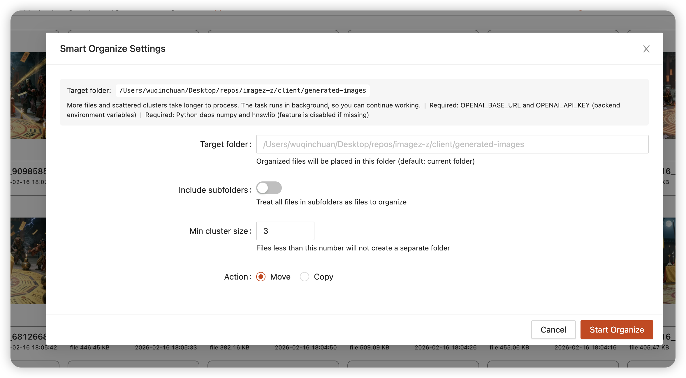
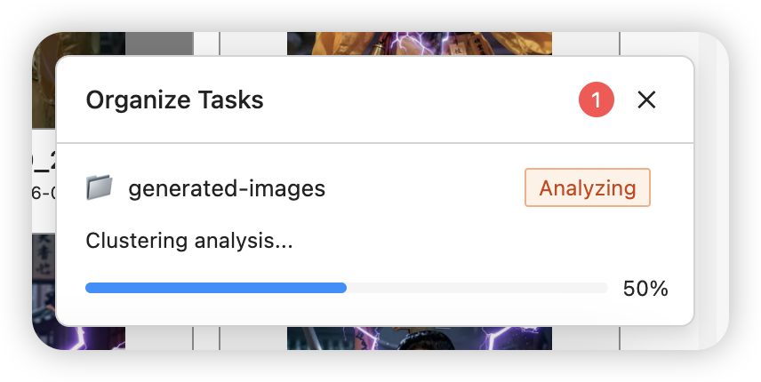
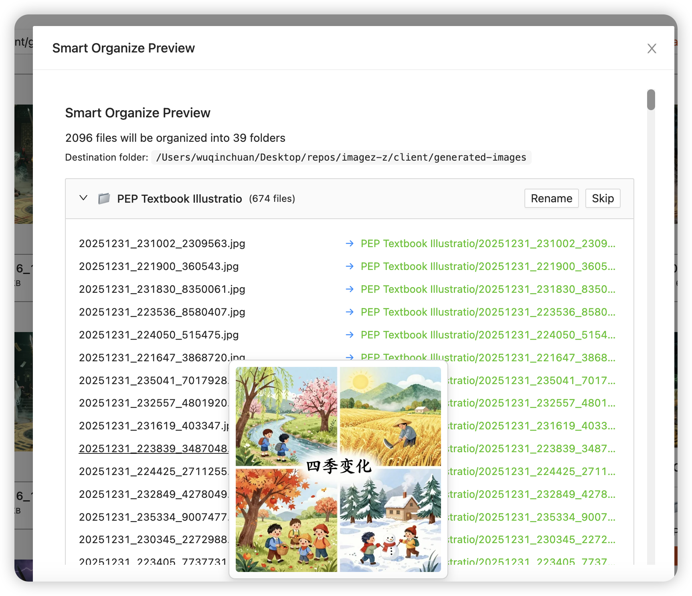
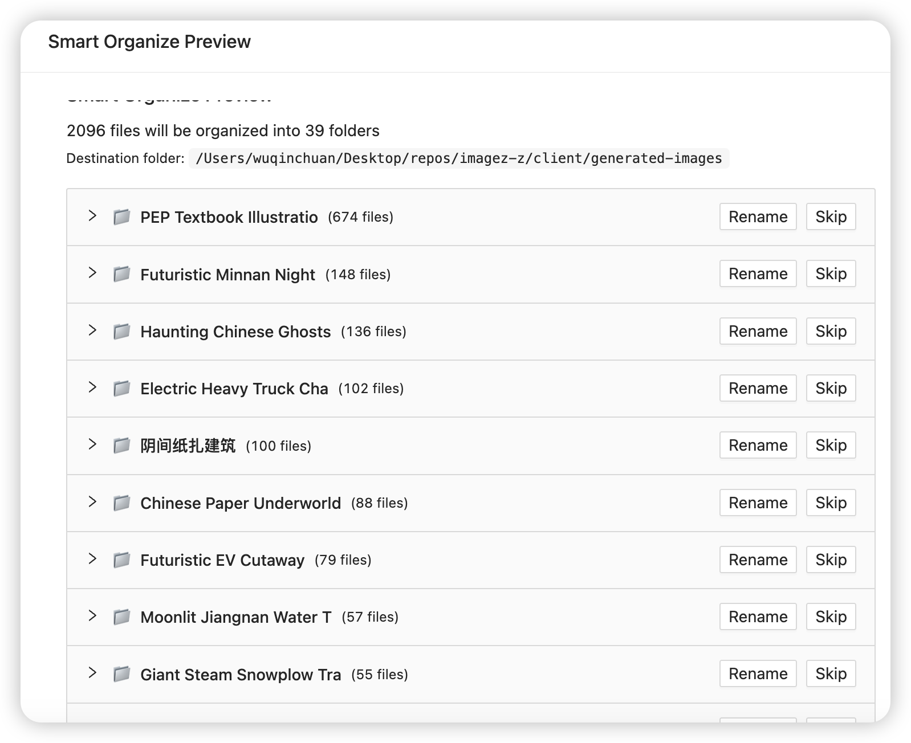
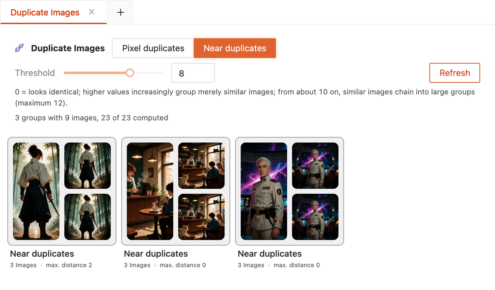
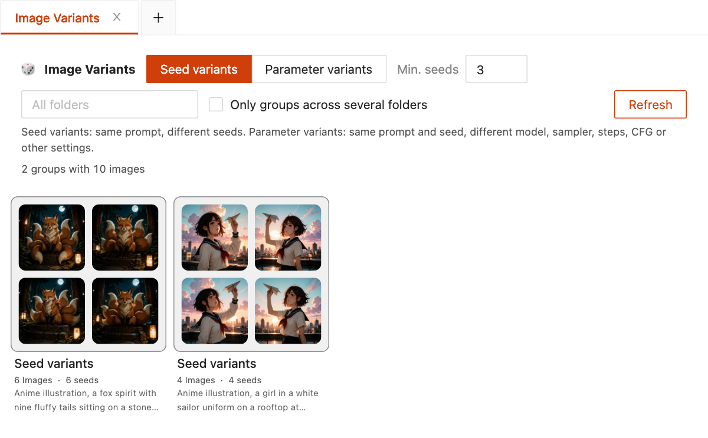
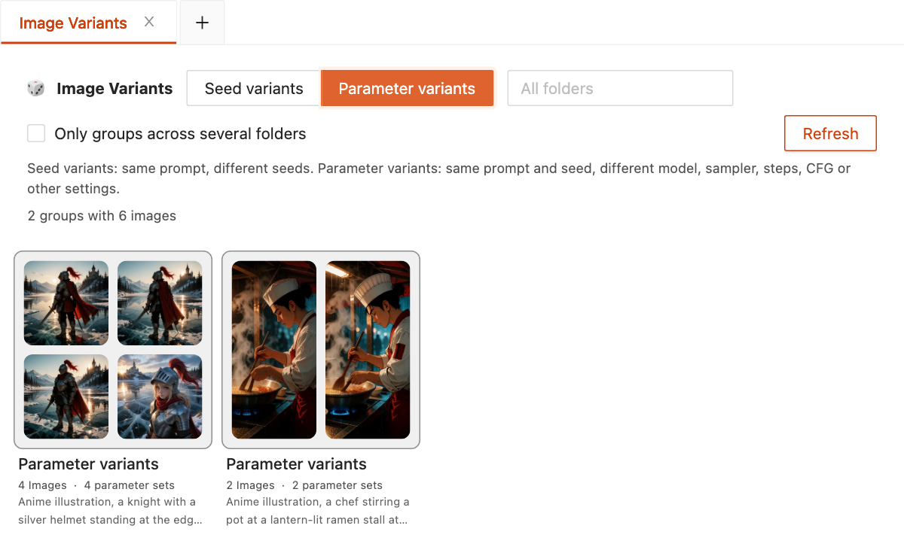

 

> ✨ **New from the same author**: [SpindleStudio](https://github.com/zanllp/SpindleStudio) — a Threads-style parallel image generation studio. Its images carry SD WebUI–compatible metadata and are indexed by IIB out of the box.

[中文文档](./README-zh.md)
[Change log](./CHANGELOG.md)
[Installation / Running](#installation--running)


#  Infinite Image Browsing (IIB)

### Software Support and Development Progress Overview
| Software               | Support          | Provided by |
| ---------------------- | ---------------- |  ----------- |
| Stable Diffusion web UI| Supported        |  Built-in    |
| Stable Diffusion web UI (Stealth)| Supported  ([default: disabled](https://github.com/zanllp/sd-webui-infinite-image-browsing/blob/main/.env.example#L49))      |  Built-in    |
| ComfyUI                | Partially supported |  Built-in    |
| Fooocus                | Supported        |  Built-in    |
| NovelAI                | Supported    |  Built-in    |
| StableSwarmUI          | Supported    |  Built-in    |
| Invoke.AI          | Supported    |  Built-in    |
| Pixiv                  | Supported        |  [pixiv_iib_plugin](https://github.com/zanllp/pixiv_iib_plugin) |

If you would like to support more software, please refer to: [parsers](https://github.com/zanllp/sd-webui-infinite-image-browsing/tree/main/scripts/iib/parsers) or [pixiv_iib_plugin](https://github.com/zanllp/pixiv_iib_plugin)

## Key Features
### 🔥 Excellent Performance
- Once caching is generated, images can be displayed in just a few milliseconds.
- Images are displayed with thumbnails by default, with a default size of 512 pixels. You can adjust the thumbnail resolution on the global settings page.
- You can also control the width of the grid images, allowing them to be displayed in widths ranging from 64px to 1024px.
- Supports pre-generating thumbnails and video covers to improve performance using `--generate_video_cover` and `--generate_image_cache`.
- Supports specifying the cache directory through the `IIB_CACHE_DIR` environment variable.
- The number of threads that compute image hashes for the [Duplicate Images](#duplicate-images) view can be set with the `IIB_IMAGE_HASH_THREADS` environment variable (default 3, between 1 and 8).

### 🔍 Image Search & Favorite
- The prompt, model, Lora, and other information will be converted into tags and sorted by frequency of use for precise searching.
- Supports tag autocomplete, [auto-translation](https://github.com/zanllp/sd-webui-infinite-image-browsing/issues/39), and customization.
- Image favorite can be achieved by toggling custom tags for images in the right-click menu.
- Support for advanced search similar to Google
- Also supports fuzzy search, you can search by a part of the filename or generated information.
- Support adding custom search paths for easy management of folders created by the user.
- Media type filtering, video tag search, and random sort.
- Auto-tagging with custom rules.

### 🖼️ View Images/Videos & `Send To`
- Supports viewing image generation information. Also supported in full-screen preview mode.
- EXIF/metadata is integrated in full-screen preview with nested JSON navigation and highlighting.
- Supports sending images to other tabs and third-party extensions such as ControlNet , openOutpaint.
- Support full-screen preview and enable custom shortcut key operations while in full-screen preview mode.
- Support navigating to the previous or next image in full-screen preview mode by pressing arrow keys or clicking buttons.
- Support playing video files from a remote server.

### 💻 Multiple Usage Methods
- You can install it as an extension on SD-webui.
- You can run it independently using Python.
- The desktop app version is also available.
- Supports multiple popular AI software.
- **NEW**: [Use with AI agents](docs/ai-agents.md) (Claude Code, Cursor, OpenClaw, etc.)


### 📊 Trend & Statistics
- GitHub-style contribution heatmap showing daily image generation activity.
- Monthly trend bar chart, top models, and top source distribution.
- Total image count and disk usage at a glance.
- Click the 📊 icon on the startup page or find "Trend" under Launch.

### 🎵 TikTok-Style View
- TikTok-style vertical browsing for images and videos.
- Polished info panel with backdrop/preview return improvements.
- Delete events stay in sync across the TikTok view.

### 🚶‍♀️ Walk Mode
- Automatically load the next folder `(similar to os.walk)`, allowing you to browse all images without paging.
- Tested to work properly with over 27,000 files.
- When there are folders, you can switch to walk mode from other modes by clicking the walk button in the upper right corner. It will flatten all the folders, avoiding the tedious operation of going in and out of folders.

### 🌳 Preview based on File Tree Structure & File operations
- Supports file tree-based preview.
- Supports automatic refreshing.
- Supports basic file operations, such as multiple selection for deleting/moving/copying, and creating new folders.
- Hold down the Ctrl, Shift, or Cmd key to select multiple items.
  - Supported multi-select operations include: delete, move, copy, pack download, add tags, remove tags, move to another folder, copy to another folder, drag and drop.
  - You can keep the multi-select state by clicking the "Keep Multi-Select" button in the lower right corner, allowing you to perform multiple operations on the selected file collection conveniently.
- Drag-and-drop into folders and safer move/copy (continue on error).

### 🆚 image comparison (similar to Imgsli)
- Provides a side-by-side comparison of two images.
- Provides a comparison of image generation information at the same time.

### 🧠 Topic/Tag Analysis
- Tag relationship graph visualization for topic clusters.

### 🧬 Duplicate Images
Find duplicate and near-duplicate images by their content, independent of file names and metadata.

- **Pixel duplicates**: images with identical pixels, even if the file name, the encoding, or the metadata differ
- **Near duplicates**: images that look almost the same (re-encoded, resized, slightly edited); a threshold sets how similar they must be
- **Folder-style tiles**: each group is a tile with a thumbnail mosaic; a click opens the group in the grid, where you select, tag, and delete as usual
- **Incremental background job**: image hashes are computed only for new and changed images, with progress and a cancel button; the view starts the job when you open it

> **Requirements**: Python dependencies `numpy` and `Pillow`
>
> 📸 See [Duplicate Images Preview](#duplicate-images) below for a screenshot and details.

### 🎲 Image Variants
Find images generated from the same prompt, grouped from their metadata.

- **Seed variants**: same prompt, different seeds (batch runs, re-rolls, the same prompt on another day)
- **Parameter variants**: same prompt and seed, different model, sampler, steps, CFG or other settings (model and sampler tests, X/Y/Z plots, runs with and without hires fix)
- **Tiles like Duplicate Images**: each group shows its number of images, of seeds or parameter sets, and the prompt; a click opens it in the grid
- **Filters**: minimum number of seeds, folders, and only groups that span several folders

> **Requirements**: Python dependency `numpy`
>
> 📸 See [Image Variants Preview](#image-variants) below for screenshots and details.

### 🗂️ Smart Organize
AI-powered automatic file organization

- **Semantic Clustering**: Automatically groups similar images based on prompt semantics using AI embeddings
- **Auto-Generated Folder Names**: AI generates meaningful folder names in your preferred language
- **Preview Before Action**: Review the proposed organization before confirming - skip or adjust as needed
- **Background Processing**: Large folders are processed in the background, you can continue working
- **Flexible Options**: Choose between move or copy, set minimum cluster size, include subfolders recursively

> **Requirements**: Same as Topic Search - requires `OPENAI_BASE_URL`, `OPENAI_API_KEY`, and Python dependencies `numpy`, `hnswlib`
>
> 📸 See [Smart Organize Preview](#smart-organize) below for screenshots and video demo.

### 🌐 Multilingual Support
- Currently supports Simplified Chinese/Traditional Chinese/English/German.
- If you would like to add a new language, please refer to [i18n.ts](https://github.com/zanllp/sd-webui-infinite-image-browsing/blob/main/vue/src/i18n/zh-hans.ts) and submit the relevant code.

### 🔐 Privacy and Security
- Supports custom secret key for authentication.
- Supports configuring access control for the file system, which will be enabled by default when the service allows public access (Only when used as an extension of sd-webui).
- Supports customizing the allowed paths for access control.
- Supports controlling access permissions. You can run IIB in read-only mode.
- [Click here to see details](.env.example)


### 📦 Packaging/Batch Download
- Allows you to download multiple images at once.
- The data source can be search results, a regular image grid view page, walk mode, etc. Images can be added to the processing list through drag-and-drop or "Send To".
### ⌨️ Keyboard Shortcuts
- Allows for deleting and adding/removing tags, with customizable trigger buttons in the global settings page.


If you like this project and find it helpful, please consider giving it a ⭐️. This would be very important for me to continue developing and maintaining this project. If you have any suggestions or ideas, please feel free to raise them in the issue section, and I will respond as soon as possible. Thank you again for your support!


<a href='https://ko-fi.com/zanllp' target='_blank'>

[Sponsor me on WeChat](.github/wechat_funding.jpg)

# Installation / Running
## As an extension for SD-webui:
1. Open the `Extensions` tab in SD-webui.
2. Select the `Install from URL` option.
3. Enter `https://github.com/zanllp/sd-webui-infinite-image-browsing`.
4. Click on the `Install` button.
5. Wait for the installation to complete and click on `Apply and restart UI`.

## As a standalone program that runs using Python. (without SD-webui):

Refer to [Can the extension function without the web UI?](https://github.com/zanllp/sd-webui-infinite-image-browsing/issues/47)

If you need to view images generated by ComfyUI/Fooocus/NovelAI, please refer to [https://github.com/zanllp/sd-webui-infinite-image-browsing/issues/202](https://github.com/zanllp/sd-webui-infinite-image-browsing/issues/202#issuecomment-1655764627).

If you need a Dockerfile, you can refer to this link.  https://github.com/zanllp/sd-webui-infinite-image-browsing/discussions/366

## As a desktop application (without SD-webui and Python):
The executable version also supports ComfyUI/Fooocus/NovelAI.

Download and install the program from the [`releases`](https://github.com/zanllp/infinite-image-browsing/releases) section on the right-hand side of the repository page.
If the antivirus detects a virus, it can be ignored as a false positive. There are two versions of the compiled version for Windows, with the pyinstaller version having a lower false positive rate.

With an updater-enabled Windows or macOS build, choose **Update now** in the app to install the next release and restart. Older builds need one last manual install.

### macOS (unsigned preview)

Choose the `aarch64-unsigned.dmg` download for Apple Silicon (M-series), or `x64-unsigned.dmg` for Intel. macOS 14 or later is required. Drag **Infinite Image Browsing** into Applications before opening it; do not run it directly from the disk image.

These builds have no Apple Developer ID signature and are not notarized. If macOS blocks the app, review [Apple's instructions for opening an unnotarized app](https://support.apple.com/en-us/102445). Only allow it if you trust the download from this repository. Do not disable Gatekeeper system-wide. An ad-hoc signature protects the integrity of bundled code, but does not make Apple trust the app.

If the trusted official download still will not start, the following command removes the download quarantine flag from **this app only**, including its bundled backend:

```sh
xattr -dr com.apple.quarantine "/Applications/Infinite Image Browsing.app"
```

This is an explicit per-app exception, not Apple verification. Do not run it on your Downloads folder or an entire disk. Both macOS architectures have been tested with this exception; the original quarantined downloads are still blocked by Gatekeeper.

The app starts a bundled Python backend. If the window opens but the backend does not start, allowing the main app alone may not have resolved the problem. Check `iib_api_server.log` in `~/Library/Application Support/com.zanllp.iib/` and include the relevant error when reporting an issue. The database, backups, `.env`, and optional `app.conf.json` also live in this directory, not inside the app bundle. Access to protected folders is controlled separately in **System Settings > Privacy & Security > Files and Folders**.

If you need to compile it yourself, please refer to https://github.com/zanllp/sd-webui-infinite-image-browsing/blob/main/.github/workflows/tauri_app_build.yml.

## As a Library Usage:

Use iframe to access IIB and use it as a file browser for your application. Refer to https://github.com/zanllp/sd-webui-infinite-image-browsing/blob/main/vue/usage.md

## As an AI Agent Skill

IIB can be used with AI agents like Claude Code, Cursor, and OpenClaw. See [AI Agents Documentation](docs/ai-agents.md) for details.

# Preview


## Image Search

During the first use, you need to click and wait for the index generation. For my case with 20,000 images, it took about 45 seconds (with an AMD 5600X CPU and PCIe SSD). For subsequent uses, it will check whether there are changes in the folder, and if so, it needs to regenerate the index. Usually, this process is very fast.

Image search supports translation, see https://github.com/zanllp/sd-webui-infinite-image-browsing/issues/39 for more detail. Feel free to share files for other languages to facilitate everyone's use.


## Full Screen Preview (Side-by-Side Layout)


## Full Screen Preview


In full-screen preview mode, you can also view image information and perform operations on the context menu. It supports dragging, resizing and expanding/collapsing .

https://user-images.githubusercontent.com/25872019/235327735-bfb50ea7-7682-4e50-b303-38159456e527.mp4

If you, like me, don't need to view the generation information, you can choose to simply minimize this panel, and all contextual operations will still be available.


## Image comparison


## Transfer files between different tab panes.
https://github.com/zanllp/sd-webui-infinite-image-browsing/assets/25872019/e631e3c3-1cbf-49bc-8577-f2963a6c9e4d
### Right-click menu


You can also trigger it by hovering your mouse over the icon in the top right corner.


### Walk mode


https://user-images.githubusercontent.com/25872019/230768207-daab786b-d4ab-489f-ba6a-e9656bd530b8.mp4


### Dark mode


## Smart Organize

AI-powered automatic file organization - groups similar images and creates meaningful folders.









https://github.com/user-attachments/assets/c1279556-d255-4e71-b230-48523a4859bf

## Duplicate Images



Groups of **pixel duplicates** and **near duplicates**, computed from the image content. Open it from the startup page (**Duplicate Images**).

### How to Use

1. Open **“Duplicate Images”** from the startup page. If images have not been hashed yet, the view starts a background job and shows its progress (**Cancel** stops it, finished work is kept).
2. Switch between **Pixel duplicates** and **Near duplicates**. For near duplicates, the **Threshold** (0–12, default 8) sets how similar images must be: `0` means "looks identical", higher values also group merely similar images, and from about 10 on similar images start to chain into large groups.
3. Each tile shows a group with its number of images (and, for near duplicates, the largest distance between two members). Click it to open the group in the grid: images are ordered by similarity, the most typical one first. Select, tag, or delete there as usual.
4. **Refresh** reloads the groups; **Compute missing** computes the hashes of images that are not hashed yet.

> The job starts by itself when at most 20000 images are missing; above that, click **Compute missing**. In read-only mode (`IIB_ACCESS_CONTROL_PERMISSION=read-only`) nothing is computed, the view only shows what has been computed before.

### How it Works

- **Pixel hash**: SHA-256 over the decoded pixels (first frame, alpha on white, 16 bit scaled to 8 bit). The EXIF orientation is ignored, so the same pixels with a different orientation tag count as pixel duplicates.
- **Perceptual hash**: 64-bit pHash (DCT of a 32×32 grayscale version). Near duplicates are the connected components of images whose Hamming distance is at most the threshold, and a group needs at least two different pixel hashes. Plain single-color images are excluded from near groups.
- **Ordering**: a 32×32 grayscale thumbnail is stored per image; inside a group, images are sorted by their correlation to the most typical one.
- **Storage**: table `image_hash` (about 1.1 KB per image). A hash is recomputed when the file size or modification time of the image changes or when the version of the procedure changes. Images that cannot be decoded are remembered as failed; images that could not be read (missing file, permissions) are retried in the next job.
- **Cost**: for about 5000 images the first run takes roughly 35 s with 3 threads; later runs only process new and changed images. Grouping of 50000 images takes a few seconds once per data state; changing the threshold afterwards is almost free.

### Configuration

- **`IIB_IMAGE_HASH_THREADS`**: threads of the hash job, default `3`, between `1` and `8`

### API Endpoints

All routes are below `/infinite_image_browsing/db/`.

- **State**: `GET image_groups_state` returns `total`, `hashed`, `failed`, `pending`, `skipped`, `version` and the running `job`
- **Start / cancel the job**: `POST image_groups_job_start` (returns `job_id`, joins a running job) and `POST image_groups_job_cancel`; both need write permission
- **Job status**: `GET image_groups_job_status?job_id=...` (`queued`, `running`, `done`, `cancelled`, `error`, with `done`, `total`, `skipped`)
- **Groups**: `POST image_groups` with `kind` (`pixel` or `near`), `threshold`, `min_size`, `offset`, and `limit` (at most 1000); each group has `id`, `size`, `max_distance`, the first four file infos in `images`, and all paths in `paths`. Continue with `next_offset` while `has_more` is true.

## Image Variants





Groups of **seed variants** and **parameter variants**, read from the generation metadata. Open it from the startup page (**Image Variants**).

### How to Use

1. Open **“Image Variants”** from the startup page. No background job is needed: the groups come from the metadata the index already holds.
2. Switch between **Seed variants** and **Parameter variants**. For seed variants, **Min. seeds** (default 3) sets how many different seeds a group needs.
3. Limit the groups to **folders** (pick a library folder or type a path), or show **only groups across several folders** to hide the seeds of a single batch.
4. Each tile shows the number of images, the number of seeds or parameter sets, and the prompt. Click it to open the group in the grid. Images are ordered by similarity where the image hashes of [Duplicate Images](#duplicate-images) exist, otherwise by date.

### How it Works

- **Prompt**: the positive prompt as raw text without `<lora:…>` tags, the negative prompt, and the LoRAs (name and weight, sorted). Images without a positive prompt or without a parameter line take no part; the view counts them. Images without a seed take no part either (the built-in ComfyUI parser writes none).
- **Seed variants**: images with the same prompt and at least the minimum number of different seeds.
- **Parameter variants**: images with the same prompt, seed and size and more than one set of generation parameters: every field of the parameter line except seed, size and source, for example model, sampler, steps, CFG, clip skip, hires fix or ADetailer.
- **Cost**: the groups are computed once per data state and cached. For 100000 images, reading and grouping takes about one second; a cached request about 0.2 s.

### API Endpoints

All routes are below `/infinite_image_browsing/db/`.

- **Groups**: `POST image_variants` with `kind` (`seed` or `params`), `min_seeds` (2–100, default 3, seed variants only), `folder_paths`, `multi_folder`, `offset`, and `limit` (at most 1000); each group has `id`, `size`, `variant_count` (seeds or parameter sets), a shortened `prompt`, the first four file infos in `images`, and all paths in `paths`. `no_prompt` counts the images without a positive prompt or parameter line. Continue with `next_offset` while `has_more` is true.

## Natural Language Categorization & Search (Experimental)

This feature groups images by **semantic similarity of prompts** and supports **natural-language retrieval** (similar to the retrieval stage in RAG).
It’s experimental: results depend on the embedding/chat models and the quality of prompt metadata.

### How to Use (for end users)

1. Open **“Natural Language Categorization & Search (Experimental)”** from the startup page
2. Click **Scope** and select one or more folders (from QuickMovePaths)
3. **Categorize**: click **Refresh** to generate topic cards for the selected scope
4. **Search**: type a natural-language query and click **Search** (auto-opens the result grid)

> The selected scope is persisted in backend KV: `app_fe_setting["topic_search_scope"]`. Next time it will auto-restore and auto-refresh once.

### API Endpoints

- **Build/refresh embeddings**: `POST /infinite_image_browsing/db/build_iib_output_embeddings`
  - Request: `folder`, `model`, `force`, `batch_size`, `max_chars`
- **Cluster (categorize)**: `POST /infinite_image_browsing/db/cluster_iib_output_job_start` then poll `GET /infinite_image_browsing/db/cluster_iib_output_job_status?job_id=...`
  - Request: `folder_paths` (required, array), `threshold`, `min_cluster_size`, `force_embed`, `title_model`, `force_title`, `use_title_cache`, `assign_noise_threshold`, `lang`
- **Prompt retrieval (RAG-like)**: `POST /infinite_image_browsing/db/search_iib_output_by_prompt`
  - Request: `query`, `folder_paths` (required, array), `top_k`, `min_score`, `ensure_embed`, `model`, `max_chars`

### How it Works (simple explanation)

- **1) Prompt extraction & normalization**
  - Reads `image.exif` and keeps content before `Negative prompt:`
  - Optionally removes “boilerplate” terms (quality/photography parameters, etc.) to focus on topic semantics (`IIB_PROMPT_NORMALIZE*`)
- **2) Embeddings**
  - Calls OpenAI-compatible `/embeddings`
  - Stores vectors in SQLite table `image_embedding` (incremental, to avoid repeated costs)
- **3) Clustering**
  - Online centroid-sum clustering, plus a post-merge step for highly similar clusters
  - Optionally reassigns members of small clusters into the closest large cluster to reduce noise
- **4) Title generation (LLM)**
  - Calls `/chat/completions` with tool/function calling to force structured JSON output
  - Stores titles/keywords in SQLite table `topic_title_cache`
- **5) Retrieval**
  - Embeds the query and ranks images in the selected scope by cosine similarity, returning TopK

### Caching & Incremental Updates

#### 1) Embedding cache (`image_embedding`)

- **Where**: table `image_embedding` (keyed by `image_id`)
- **Skip rule (incremental update)**: an image is skipped if:
  - same `model`
  - same `text_hash`
  - existing `vec` is present
- **Re-vectorization cache key**: `text_hash = sha256(f"{normalize_version}:{prompt_text}")`
  - `prompt_text` is the extracted + (optionally) normalized text used for embeddings
  - `normalize_version` is a **code-derived fingerprint** of normalization rules/mode (not user-configurable)
- **Force rebuild**: pass `force=true` to `build_iib_output_embeddings` or `force_embed=true` to `cluster_iib_output_job_start`

#### 2) Title cache (`topic_title_cache`)

- **Where**: table `topic_title_cache` keyed by `cluster_hash`
- **Hit rule**: when `use_title_cache=true` and `force_title=false`, titles/keywords are reused
- **Cache key (`cluster_hash`) includes**:
  - member image IDs (sorted)
  - embedding `model`, `threshold`, `min_cluster_size`
  - `title_model`, output `lang`
  - normalization fingerprint (`normalize_version`) and mode
- **Force title regeneration**: `force_title=true`

### Configuration (Environment Variables)

All calls use an **OpenAI-compatible** provider:

- **`OPENAI_BASE_URL`**: e.g. `https://your-host/v1`
- **`OPENAI_API_KEY`**: your API key
- **`EMBEDDING_MODEL`**: embeddings model used for clustering and semantic search
- **`AI_MODEL`**: default chat model (fallback)
- **`TOPIC_TITLE_MODEL`**: chat model used for cluster titles (falls back to `AI_MODEL`)
- **`IIB_PROMPT_NORMALIZE`**: `1/0` enable prompt normalization
- **`IIB_PROMPT_NORMALIZE_MODE`**: `balanced` (recommended) / `theme_only`

##### Optional: TwelveLabs Marengo embedding backend

Embeddings normally go to an OpenAI-compatible `/embeddings` endpoint. As an opt-in
alternative you can embed prompt text with [TwelveLabs](https://twelvelabs.io) Marengo,
which embeds text/image/audio/video into one shared latent space:

- Set **`EMBEDDING_MODEL=marengo3.0`**.
- Set **`TWELVELABS_API_KEY`** to your TwelveLabs key (falls back to `OPENAI_API_KEY` if
  unset, for backward compatibility). `OPENAI_BASE_URL` is ignored for embeddings, and the
  OpenAI-compatible chat path used for cluster titles is unaffected.
- Install the optional dependency: `pip install 'twelvelabs>=1.2.8'`.

This is fully opt-in and non-breaking — the default OpenAI-compatible path is unchanged
unless you select a Marengo model. You can grab a free API key (generous free tier) at
<https://twelvelabs.io>.

> Note: There is **no mock fallback** for AI calls. If the provider/model fails or returns invalid output, the API will return an error directly.

## Testing

The unit tests need no SD-webui, no GPU and no network:

```bash
python -m pytest tests/unit
```

Run them from the repository root, otherwise `scripts.iib` cannot be imported.
`tests/unit/test_api_file_write.py` calls every endpoint that changes files
(`rename`, `delete_files`, `copy_files`, `move_files`, `update_exif`,
`flatten_folder`, `extra_paths`, `organize_files_start`, `import_user_data`)
through the real FastAPI app, including which paths they are allowed to touch
when access control is on. Everything happens inside temporary directories, so
your library and database are not touched.
